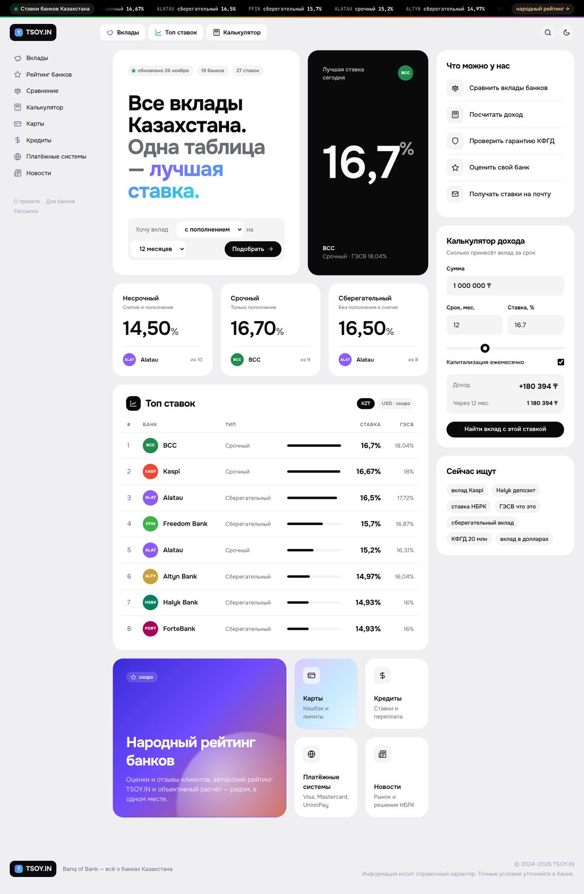
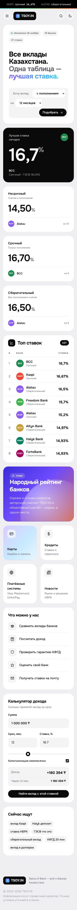
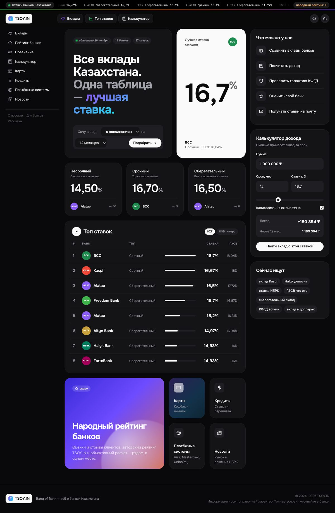

# TSOY.IN · Banq of Bank

Портал о банках Казахстана: депозиты, карты, кредиты, пакеты услуг, платёжные системы, рейтинги (авторский, объективный, народный), новости и аналитика.



 

## Быстрый старт (локально)

```bash
composer install
npm ci && npm run build
php artisan serve
```

Открой http://127.0.0.1:8000 — запустится мастер установки (выбери SQLite для пробы).

## Установка на сервер (BrainyCP)

1. Создай сайт с document root `/home/tsoy/sites/banqofbank/public`, PHP 8.3, базу MySQL и пользователя.
2. `git clone https://github.com/tsoyce/Banq.git /home/tsoy/sites/banqofbank && cd /home/tsoy/sites/banqofbank && bash deploy.sh`
3. Открой сайт → мастер установки проверит сервер, подключится к БД, создаст таблицы и администратора.
4. Админка → «Импорт Excel» → загрузи файл со ставками.

## Документация

- [docs/PLAN.md](docs/PLAN.md) — стек, архитектура, модель данных, этапы
- [docs/REGISTRY.md](docs/REGISTRY.md) — реестр: дерево, граф зависимостей, таблицы, переменные, маршруты
- [docs/JOURNAL.md](docs/JOURNAL.md) — журнал действий A01, A02…
